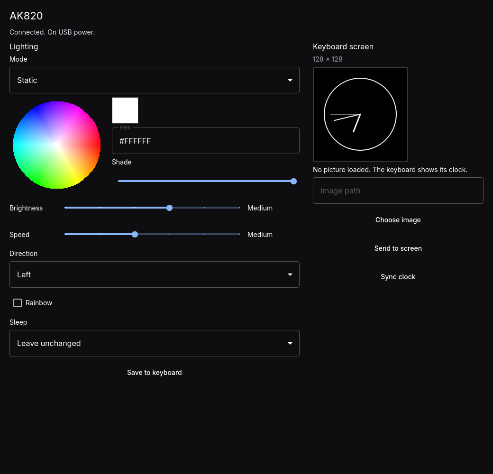

# AJAZZ_AK820_PRO_Custom_App

**A desktop app and command-line tool for the AJAZZ AK820 Pro on Linux, macOS, and Windows.**

I wanted to avoid installing the sketchy Chinese utility AJAZZ recommends, so I made this small, inspectable alternative to talk to the keyboard directly. For my setup, fewer mystery installers feels like the safer choice. Your keyboard gets its colors without inviting an unknown app along for the ride.

Adjust RGB lighting and sleep behavior, sync the keyboard clock, and put a still image on its 128 × 128 screen. The desktop app gives you a visual color picker and controls. The CLI makes the same core settings easy to script.

[](https://github.com/sdpursley/AJAZZ_AK820_PRO_Custom_App/actions/workflows/release.yml)
[](https://github.com/sdpursley/AJAZZ_AK820_PRO_Custom_App/releases/latest)



## Features

- Set a static lighting color or choose a lighting mode, brightness, speed, direction, and rainbow option.
- Choose when the keyboard goes to sleep.
- Sync the keyboard clock with your computer.
- Send an image to the keyboard screen. Images are center-cropped to a square and scaled to 128 × 128 pixels. This replaces custom screen slot 1.
- Use the graphical interface or JSON-friendly command-line commands.
- Localized interface, currently including English and Danish.

Keyboard changes are sent when you apply them. In the desktop app, lighting and sleep settings are written with **Save** (Space). Moving a control alone does not write settings to the keyboard.

## Download

Download a platform build from [GitHub Releases](https://github.com/sdpursley/AJAZZ_AK820_PRO_Custom_App/releases/latest).

- **Windows:** Download `ak820-windows-x64.zip`, extract it, and launch `ak820.exe`. Windows may show a SmartScreen warning because the app is not code signed.
- **macOS Apple silicon:** Download `ak820-macos-arm64.zip`, open the app, and approve it in Gatekeeper if prompted. This community build is not signed with a Developer ID certificate or notarized.
- **macOS Intel:** Download `ak820-macos-x64.zip`, open the app, and approve it in Gatekeeper if prompted. This community build is not signed with a Developer ID certificate or notarized.
- **Linux:** Download `ak820-linux-x86_64.tar.gz` and run the included `ak820` binary. It requires Qt 6 and HIDAPI runtime libraries. Arch users can instead build and install the included package.

Windows and macOS builds are new and need testing with physical keyboards. Linux is the currently hardware-tested platform.

## Build and run on Linux

Requirements: Qt 6, HIDAPI, a C++17 compiler, `qmake6`, and `make`.

```sh
./bin/build
./bin/setup-udev  # one time, then unplug and reconnect the keyboard
./build/ak820
```

To install the Arch package on an Arch-based system:

```sh
./bin/install
```

## Command line

The built executable is `build/ak820`. Add `--json` to get a single JSON result object. Commands return exit status 0 on success and 1 on failure.

```sh
./build/ak820 probe --json
./build/ak820 lighting --mode static --color ff8800 --brightness 3 --json
./build/ak820 sleep --minutes 5 --json
./build/ak820 clock --json
./build/ak820 screen --image picture.png --json
```

The lighting command also accepts `--speed`, `--direction`, and `--rainbow`. The sleep timeout can be set to never, 1, 5, or 30 minutes. Run `./build/ak820` without a command to open the app.

## Keyboard shortcuts

| Key | Action |
| --- | --- |
| Space | Save lighting and sleep settings to the keyboard |
| S | Send the selected image to the screen |
| C | Sync the keyboard clock |
| I | Choose an image |
| ? | Show or hide shortcut help |
| Escape | Close shortcut help |
| Q | Quit |

## License

AK820 is released under the [MIT License](LICENSE).
